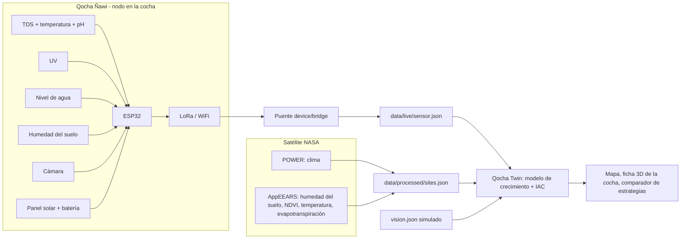

# Qocha Ñawi: diseño de referencia (sensores, bloques, 3D y valores simulados)

Frente **Campo y Satélite** (Paolo). Documento de diseño: **no hay prototipo construido**. Las mediciones que muestra el gemelo son **simuladas** y así deben presentarse en el video y el pitch.

> Todos los rangos de crecimiento son **supuestos del modelo** (`twin/src/model.ts`), tomados de la literatura y sin validar en campo. Los modelos de sensor son propuestas comerciales comunes, no una compra hecha.

## 1. Sensores propuestos

| Variable | Sensor propuesto | Por qué importa | ¿En el contrato `sensor.json`? | ¿Lo usa el modelo? |
|---|---|---|---|---|
| **TDS / conductividad** | Sonda TDS analógica tipo DFRobot SEN0244 (con compensación por temperatura) | Variable clave: el cushuro pide agua con pocos sólidos disueltos | Sí (`tds_ppm`) | Sí |
| **Temperatura del agua** | DS18B20 sumergible | Condiciona el crecimiento y compensa el TDS | Sí (`temp_agua_c`) | Sí |
| **pH** | Sonda de pH analógica | Calidad del agua | Sí, opcional (`ph`) | No (informativo) |
| **Radiación UV** | Sensor UV tipo GUVA-S12SD | Estrés o estímulo de la colonia | Sí, opcional (`uv_index`) | Sí |
| **Nivel de agua** | Sensor de presión en el ancla (tipo Bar30). *Un ultrasónico sobre el flotador no sirve: ver `SENSORES.md`, sección 5.* | Si la cocha se seca o se desborda | **No** | Sí (`profundidad_m`) |
| **Humedad del suelo** | Capacitivo en la orilla y en el terreno vecino | Dato de suelo in situ que valida a SMAP (9 km) y alimenta el comparador de estrategias | **No** | No (todavía) |
| **Turbidez** | Sensor de turbidez analógico | Luz disponible en el agua | **No** | No |
| **Cámara** | ESP32-CAM | Foto time-lapse; en el hackathon la visión es simulada | Va en `vision.json` | Sí (vía visión) |
| **Posición** | GPS tipo NEO-6M | Ubicar la cocha | Va en `sites.json` | No |
| **Comunicación y energía** | LoRa SX1276, panel solar 6 V + cargador + batería 18650 | Operar sin red y sin enchufe en el bofedal | — | — |

**Dos huecos del contrato.** El modelo usa `profundidad_m`, pero hoy la asume en 0,4 m porque el sensor no la mide. La humedad del suelo no existe en el contrato. Si se quieren, hay que añadir `profundidad_m` y `humedad_suelo_pct` a `data/contracts/sensor.schema.json`, y **Pax debe aprobar** el cambio. Mientras tanto, la profundidad sigue siendo un supuesto.

## 2. Diagrama de bloques



**Flujo de datos real frente a simulado**

| Tramo | Hackathon |
|---|---|
| Sensores → ESP32 → puente | **Simulado** (un generador escribe `data/live/sensor.json` con el formato del contrato) |
| Satélite → `sites.json` | Real si Adrián logra extraerlo; si no, valores de ejemplo |
| Visión → `vision.json` | **Simulada** |
| Gemelo (modelo, IAC, 3D) | Real: es código que corre en vivo |

## 3. Diseño 3D de referencia (para el gemelo)

Una **estación flotante** sobre la cocha. La describo con formas simples para que Pax la monte con primitivas (por ejemplo three.js) sin modelar nada a mano.

```
        ☀  panel solar (placa inclinada 20°)
         ╲▔▔▔╲
   UV ●   ╲   ● antena LoRa
          ┃ mástil (≈ 80 cm)
   cámara ◉┫  ← apunta hacia abajo, al agua
          ┃
   ╔══════╩══════╗  caja estanca con ESP32 y batería
   ╚═══╤═══════╤═╝
 ~~~~~~│~~~~~~~│~~~~~~~  ← superficie del agua
   flotador   brazo con sensor de nivel (ultrasónico)
       │
       ╽ sonda colgante: TDS + temperatura + pH (≈ 15 cm bajo el agua)
   ────┴──── cuerda al ancla
   en la orilla:  ┃ estaca con sensor de humedad del suelo (cable a la caja)
```

**Medidas referenciales** (ilustrativas): flotador de unos 30 cm de diámetro; mástil de unos 80 cm; sonda a unos 15 cm de profundidad.

**Qué se ve en el gemelo (la cocha viva alrededor de la estación)**
- Un disco de agua con la profundidad medida por el sensor de nivel.
- **Colonias de cushuro** como esferitas verdes: su número y tamaño siguen la `biomasa_kg` o la cobertura.
- **Etiquetas flotantes** sobre cada sensor con su lectura actual (`TDS 40 ppm`, `9,5 °C`…), que cambian cuando llegan datos nuevos.
- El color del agua y de las colonias refleja el **estado de crecimiento** (sección 4).

## 4. Estado de crecimiento: valores coherentes con el modelo

El estado sale de un número que el modelo ya calcula. Con `f_total = f(T) · f(UV) · f(TDS) · f(profundidad)`, la tasa diaria es `r = 0,06 · f_total`. Propongo cuatro estados según `f_total`:

| Estado | `f_total` | Color sugerido | Mensaje al productor |
|---|---|---|---|
| **Óptimo** | ≥ 0,75 | Verde intenso | "Condiciones óptimas" |
| **Activo** | 0,40 – 0,75 | Verde claro | "Crece bien" |
| **Lento** | 0,10 – 0,40 | Amarillo | "Crece despacio: revisa agua o sombra" |
| **Detenido** | < 0,10 | Rojo o gris | "Sin crecimiento: busca otra cocha" |

Los umbrales son propuestos, no salen del modelo. Los valores de abajo los calculé con las curvas de `RANGES` en `twin/src/model.ts` (cada factor entre 0 y 1) y con el crecimiento logístico (biomasa inicial 2 kg, capacidad 40 kg, objetivo 80 % de la capacidad).

| Escenario | Temp. agua | UV | TDS | Prof. | f(T) | f(UV) | f(TDS) | f(prof.) | `f_total` | Tasa/día | Días hasta cosechar* | Estado |
|---|---|---|---|---|---|---|---|---|---|---|---|---|
| **A. Óptimo** | 11 °C | 9 | 40 ppm | 0,4 m | 1,00 | 1,00 | 1,00 | 1,00 | **1,00** | 6,0 % | ≈ 73 | Óptimo |
| **B. Casi óptimo** | 16 °C | 12 | 120 ppm | 0,3 m | 0,90 | 0,80 | 0,90 | 1,00 | **0,65** | 3,9 % | ≈ 112 | Activo |
| **C. Sólidos altos** | 12 °C | 9 | 200 ppm | 0,4 m | 1,00 | 1,00 | 0,50 | 1,00 | **0,50** | 3,0 % | ≈ 145 | Activo |
| **D. Agua fría** | 4 °C | 6 | 40 ppm | 0,4 m | 0,50 | 1,00 | 1,00 | 1,00 | **0,50** | 3,0 % | ≈ 145 | Activo |
| **E. Poca agua** | 11 °C | 9 | 40 ppm | 0,1 m | 1,00 | 1,00 | 1,00 | 0,33 | **0,33** | 2,0 % | ≈ 218 | Lento |
| **F. Cálida y soleada** | 19 °C | 14 | 100 ppm | 0,4 m | 0,60 | 0,40 | 1,00 | 1,00 | **0,24** | 1,4 % | ≈ 302 | Lento |
| **G. Mala cocha** | 23 °C | 15 | 280 ppm | 0,4 m | 0,20 | 0,20 | 0,10 | 1,00 | **0,004** | ≈ 0 % | no llega | Detenido |

\* Días desde 2 kg hasta el 80 % de la capacidad, si las condiciones se mantienen constantes. La temporada de lluvias dura unos 4 meses (≈ 120 días), así que solo el escenario A llega a tiempo. Es un efecto del modelo, no un dato de campo.

**Cómo usarlo en la demo.** Una secuencia de lecturas que pase de **G → E → B → A** cuenta en 20 segundos la historia: "mejoramos el agua y la cocha pasa de detenida a óptima". Cada escenario tiene el mismo formato del contrato, así que se escribe en `data/live/sensor.json` y el gemelo reacciona solo.

**Lecturas de noche.** El modelo usa `uv_index = 0` de noche, y con UV 0 la aptitud de UV es 0, o sea tasa cero. Los escenarios usan lecturas diurnas. Si se simula un día completo, conviene que Pax decida si la noche detiene el crecimiento (el modelo hoy lo hace así).

## 5. Qué entrego a cada uno

| Para | Entregable |
|---|---|
| **Pax** | Lecturas simuladas con formato del contrato, escenarios A–G, y la propuesta de campos nuevos (`profundidad_m`, `humedad_suelo_pct`) para que apruebe o descarte. Las primitivas 3D de la sección 3. |
| **El grupo (video y pitch)** | Diagrama de bloques, la estación 3D en el gemelo, y la secuencia G → E → B → A como escena. |
| **Adrián** | El `cocha_id` común y la variable de humedad del suelo del lado satelital, para compararla con la del sensor. |

## 6. Cómo presentarlo con honestidad

- "Diseño del dispositivo y **mediciones simuladas** con valores coherentes con el modelo", no "sensor en funcionamiento".
- La estación 3D es **referencial**.
- Los umbrales de crecimiento son **supuestos** pendientes de validación con literatura y datos de campo.
